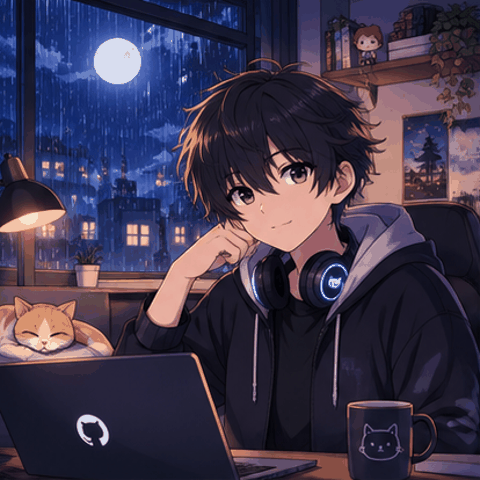

<h2>Hey there, welcome to my little corner of GitHub! ☕🌙</h2>

### 🌧️ Code, create, explore — one cozy commit at a time.

## 🌙 About Me

Hi, I'm **Agus Marsadualan** (`Gumarrs`). I enjoy building web applications, exploring full-stack development, and experimenting with AI and emerging technology.

- 💻 **Focus:** Full Stack Development
- 🤖 **Curious about:** AI, new tools, and emerging tech
- 🧩 **Enjoy:** Turning ideas into useful applications
- 🌙 **Off-screen:** Anime, cozy desk setups, and late-night inspiration

> *Turning curiosity into code, and ideas into something real.*

## 🧰 Tech Stack & Tools

## 🚀 Recently Updated Public Projects

<!-- PROJECTS:START -->
<!-- This section is automatically updated by .github/workflows/update-projects.yml -->
- Projects will be listed here after the **Update public projects** workflow runs.
<!-- PROJECTS:END -->

## 📊 GitHub Overview

## 🐍 Contribution Snake

### 🫖 Thanks for stopping by. Stay curious, keep building.

