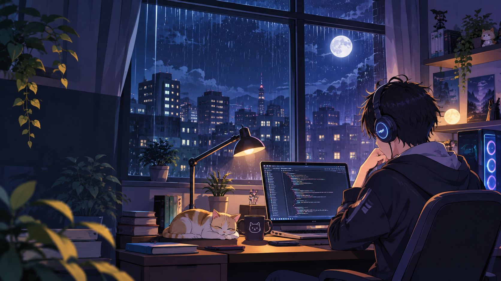

### ☕ Code, create, explore — one cozy commit at a time.

## 🌙 About Me

Hi, I'm **Agus Marsadualan** — a developer who enjoys building web applications, learning new technologies, and exploring the possibilities of AI.

- 💻 Full Stack Development
- 🤖 AI & emerging technology enthusiast
- 🌱 Always learning, experimenting, and building
- 🌙 Anime, cozy setups, and creative ideas

> *Turning curiosity into code, and ideas into something real.*

## 🧰 Tech Stack & Tools

## 🚀 Featured Projects

<table>
<tr>
<td width="50%">
<h3>🛍️ AgusStore</h3>

E-commerce project built with Vue and Laravel.

<a href="https://github.com/Gumarrs/agusstore">View repository →</a>
</td>
<td width="50%">
<h3>📝 NodeJS CRUD</h3>

Simple shopping-list CRUD application using Node.js and Express.

<a href="https://github.com/Gumarrs/nodejs-crud-part1">View repository →</a>
</td>
</tr>
<tr>
<td width="50%">
<h3>🌐 Web Resto Agus</h3>

Web programming project.

<a href="https://github.com/Gumarrs/web_resto_agus">View repository →</a>
</td>
<td width="50%">
<h3>💼 My Portfolio</h3>

Personal portfolio and ongoing development playground.

<a href="https://github.com/Gumarrs/myportfolio">View repository →</a>
</td>
</tr>
</table>

## 📊 GitHub Overview

## 🐍 Contribution Snake

### 🌧️ Thanks for stopping by. Stay curious, keep building.

